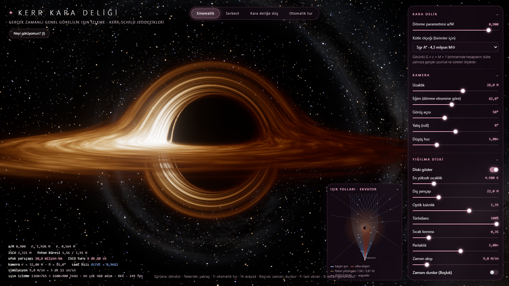
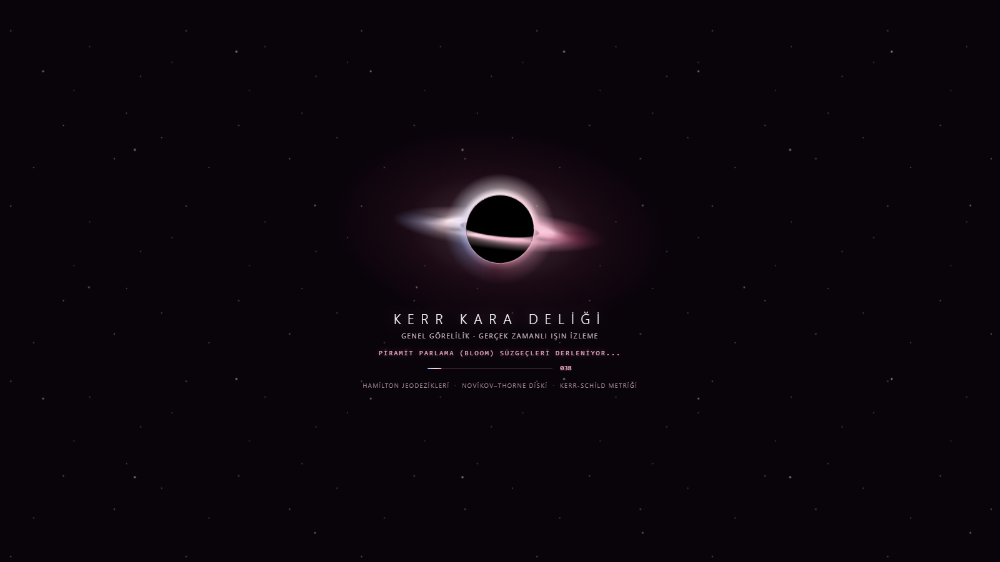

<div align="center">

# ✦ Kerr Kara Deliği Simülasyonu

**WebGL 2 ile Tarayıcıda Gerçek Zamanlı Genel Görelilik Işın İzleme**

[](https://hfatih.github.io/blachole-simulation/)
[](https://blackhole.hfatih.com)
[](#starlit--göksel-gül-tasarım-sistemi)

<br/>

[](https://www.khronos.org/registry/webgl/specs/latest/2.0/)
[](https://developer.mozilla.org/en-US/docs/Web/JavaScript)
[](https://www.khronos.org/registry/OpenGL/specs/es/3.0/GLSL_ES_Specification_3.00.pdf)
[](LICENSE)
[](#)

[✦ Canlı Simülasyon (blackhole.hfatih.com)](https://blackhole.hfatih.com) · [GitHub Pages](https://hfatih.github.io/blachole-simulation/) · [English](README.md) · [Türkçe](README.tr.md)

<br/>

<p align="center">
  
</p>

<p align="center">
  <br/>
  <em>Çift katmanlı göreli disk ve mikro yıldız tozu içeren anlık 3D dönen optik kara delik yükleme ekranı.</em>
</p>

<p align="center">
  <em>Dönen bir Kerr kara deliğinin eğri uzay-zamanında etkileşimli jeodezik ışık ışını izleme.<br/>Özel <strong>Starlit / Göksel Gül</strong> tasarım sistemi: derin obsidiyen erik, göksel pembe parıltı, cam morfoloji ve anında açılan 3D yükleme ekranı.</em>
</p>

</div>

---

## İçindekiler

- [Genel Bakış](#genel-bakış)
- [Öne Çıkan Özellikler](#öne-çıkan-özellikler)
- [Starlit / Göksel Gül Tasarım Sistemi](#starlit--göksel-gül-tasarım-sistemi)
  - [Arayüz ve Renk Paleti Felsefesi](#arayüz-ve-renk-paleti-felsefesi)
  - [3D Dönen Kara Delik Yükleme Ekranı](#3d-dönen-kara-delik-yükleme-ekranı)
- [Fizik ve Göreli Optik](#fizik-ve-göreli-optik)
  - [Kerr-Schild Metriği ve Jeodezikler](#kerr-schild-metriği-ve-jeodezikler)
  - [Novikov–Thorne Yığılma Diski](#novikovthorne-yığılma-diski)
  - [Doppler Etkisi ve Kütleçekimsel Kırmızıya Kayma](#doppler-etkisi-ve-kütleçekimsel-kırmızıya-kayma)
  - [Kara Delik Gölgesi, Foton Halkası ve Ergosfer](#kara-delik-gölgesi-foton-halkası-ve-ergosfer)
  - [Zamansı Serbest Düşüş (Kara Deliğe Düşüş)](#zamansı-serbest-düşüş-kara-deliğe-düşüş)
  - [EHT (Event Horizon Telescope) Benzetimi](#eht-event-horizon-telescope-benzetimi)
- [Grafik Motoru ve Çalışma Mantığı](#grafik-motoru-ve-çalışma-mantığı)
  - [Kasmayan Aşamalı Başlatma ve Yükleme Ekranı](#kasmayan-aşamalı-başlatma-ve-yükleme-ekranı)
  - [Zamansal Kenar Yumuşatma ve Üst Örnekleme (TAAU)](#zamansal-kenar-yumuşatma-ve-üst-örnekleme-taau)
  - [Çift Piramit Parlama (Bloom) ve Ton Eşleme](#çift-piramit-parlama-bloom-ve-ton-eşleme)
  - [Kodla Üretilen Kozmik Çevre](#kodla-üretilen-kozmik-çevre)
- [Hızlı Başlangıç](#hızlı-başlangıç)
- [Kontroller ve Kısayollar](#kontroller-ve-kısayollar)
- [Hazır Sahneler (Presets)](#hazır-sahneler-presets)
- [URL Parametreleri](#url-parametreleri)
- [Fizik Doğrulaması ve Testler](#fizik-doğrulaması-ve-testler)
- [Proje Dosya Yapısı](#proje-dosya-yapısı)
- [Bilimsel Kaynaklar](#bilimsel-kaynaklar)

---

## Genel Bakış

Bu proje, dönen (Kerr) bir kara deliğin eğri uzay-zamanında Einstein'ın Genel Görelilik Teorisi denklemlerini tarayıcınızda doğrudan çözen gerçek zamanlı bir fizik simülasyonudur. Ekrandaki her piksel, gözlemcinin kamera tetradından uzay-zamanda geriye doğru izlenen bir ışık ışını (sıfır jeodezik) olarak hesaplanır.

Geleneksel üç boyutlu grafiklerde kullanılan doku hileleri veya önceden render edilmiş sahte görseller yerine bu simülatör:
- Kerr-Schild koordinatlarında analitik metrik ve Christoffel türevlerini hesaplar.
- Novikov–Thorne modeliyle gerçekçi sıcaklık ve diferansiyel Kepler hız alanını simüle eder.
- Kara cisim Planck ışımasını göreli Doppler faktörünün dördüncü kuvvetiyle ($g^4$) renklendirir.
- Olay ufkunu tekillik olmadan geçerek iç Cauchy ufkuna kadar serbest düşüş yapabilir.
- Sıfır dış görsel dosyası veya 3B model: Samanyolu, nebulalar, toz şeritleri, disk türbülansı ve yıldızlar tamamen GLSL koduyla anlık üretilir.

---

## Öne Çıkan Özellikler

- **Kuramsal Doğruluk**: Hamilton denklemleri, ufukta tekil olmayan Kerr-Schild koordinatlarında analitik türevlerle ve uyarlanır adımlı 4. derece Runge-Kutta (RK4) sayısal integrasyonuyla çözülür.
- **Yığılma Diski Fiziği**: Novikov–Thorne (Page–Thorne) ince disk modeli, ISCO (en içteki kararlı dairesel yörünge) iç sınırı, diferansiyel dönme, viskoz türbülans ve ışığın yol alma süresi gecikmesi.
- **Göreli Optik**: Kütleçekimsel merceklenme, Einstein halkaları, çoklu görüntüler, Doppler kayması (yaklaşan taraf maviye kayıp parlar, uzaklaşan taraf kızıllaşıp söner) ve kütleçekimsel kırmızıya kayma.
- **Kara Deliğe Serbest Düşüş**: Gerçek bir zamansı jeodezik üzerinde durgun halden bırakılarak olay ufkundan içeri giriş; anlık özzaman ($\tau$) ve metrik katsayılarını gösteren HUD telemetrisi.
- **Işık Yolları Diyagramı**: Ekvator düzleminde kameradan çıkan ışık ışınlarının foton küresi etrafında nasıl büküldüğünü gösteren canlı 2D diyagram tuvali.
- **EHT Teleskop Görünümü**: Event Horizon Telescope'un 1,3 mm VLBI çözünürlüğünü taklit eden çok ölçekli Gauss filtreleme modu (M87* ve Sgr A* gözlemleri benzeri).
- **Starlit / Göksel Gül Estetiği**: Derin obsidiyen erik tonu (`#150a14`), göksel pembe kontroller (`#f0abc5`), saydam cam paneller (`blur(20px)`) ve anında açılan 3D dönen kara delik yükleme ekranı.
- **Uyarlanır Performans**: Dinamik çözünürlük ölçekleme ve TAAU sayesinde farklı GPU güçlerinde 60 FPS hedefi korunur.

---

## Starlit / Göksel Gül Tasarım Sistemi

Simülasyonun kullanıcı arayüzü, derin uzay telemetrisi ile estetik zarafeti birleştiren imza **Starlit / Göksel Gül** tasarım sistemiyle hazırlanmıştır:

<div align="center">
  
</div>

<br/>

### Arayüz ve Renk Paleti Felsefesi

| Tasarım Katmanı | Renk Kodu | Görsel İşlev ve Uygulama |
| :--- | :---: | :--- |
| **Kozmik Derin Uzay** | `#150a14` · `#07040a` | Derin obsidiyen erik ve kadife uzay boşluğu zemin |
| **Cam Kartlar (Glassmorphism)** | `rgba(25, 12, 24, 0.68)` | Çok geçişli arkaplan bulanıklığı (`backdrop-filter: blur(20px)`), `18px` kavisli köşeler ve iç ışıma |
| **Kenarlık Çizgileri** | `rgba(240, 171, 197, 0.20)` | Telemetri kontrollerini kozmik ışınlardan ayıran zarif pembe kılcal sınırlar |
| **Göksel Gül (Celestial Rose)** | `#f0abc5` | Birincil telemetri ışıltısı, aktif mod halkaları ve ISCO yörünge çizgileri |
| **Yıldız Işığı Pembesi** | `#ffd3e0` | İkincil vurgular, kaydırıcı (slider) gradyan dolguları ve tipografi parıltısı |
| **Doppler Camgöbeği** | `#8fb7ff` | Göreli kinematik maviye kayma ve kaçan ışık vektörleri |
| **Mod Seçici (Kapsül)** | Yüzen Hap Butonlar | Cam taban üzerinde parıldayan pembe aktif durum (`.on`) ve kırmızımsı dalış (`.plunge`) |
| **2D Ekvator Diyagramı** | Canlı Tuval | `#f0abc5` ISCO çizgisi, dönme yön oku ve kamera konumuyla gerçek zamanlı ışık yolları |

### 3D Dönen Kara Delik Yükleme Ekranı

<div align="center">
  
</div>

<br/>

Kişisel portfolyo tasarımından ödünç alınıp fizik motoruna uyarlanmıştır:
- **3D Optik Örtme (Occlusion)**: Yığılma diski iki bağımsız derinlik katmanından oluşur (arkada `.loader__disk` ve gölgenin içine yerleştirilmiş `clip-path: inset(50% 0 0 0)` ile ön tarafta dönen `.loader__disk--front`). Bu sayede diskin ön yarısı olay ufkunun önünden geçerken arka yarısı deliğin arkasında kalır ve gerçek 3D optik mercek hissi verir.
- **Çift Zıt Konik Türbülans**: $2,8\text{ sn}$ ve $7,0\text{ sn}$ periyotlarla zıt yönlerde dönen iki konik gradyan katmanı ve $6^\circ$ eksen eğikliği ile diskin türbülanslı diferansiyel kayması modellenir.
- **Sıfır Gecikmeli İlk Boyama (First Paint)**: HTML'de doğrudan `<body>` etiketinin en tepesinde yer alır. Tüm yapay gecikmeler ve CSS bulanıklık beklemeleri kaldırılarak sayfanın ilk açılış milisaniyesinde (frame 0) karadeliğin, parıltının ve yıldızların eksiksiz görünmesi sağlanmıştır; boş ekran beklemesi yoktur.
- **Tabular Mono Telemetri**: Monospace ilerleme sayacı (`000%` – `100%`), ışıltılı gradyan ilerleme çubuğu ve simülasyon başladığında yumuşak çözülerek kaybolma geçişi (`.is-leaving`).

---

## Fizik ve Göreli Optik

### Kerr-Schild Metriği ve Jeodezikler

Kütlesi $M$, dönme parametresi $a = J/M$ olan yüksüz, dönen bir kara deliğin uzay-zaman geometrisi Kartezyen Kerr-Schild koordinatlarında $(t, x, y, z)$ şu formdadır:

$$g_{\mu\nu} = \eta_{\mu\nu} + 2 H l_\mu l_\nu$$

Burada $\eta_{\mu\nu} = \text{diag}(-1, 1, 1, 1)$ Minkowski metriği, $l_\mu$ bir sıfır vektör alanı ($g^{\mu\nu} l_\mu l_\nu = 0$) ve $H$ skalar fonksiyonudur:

$$H = \frac{M r^3}{r^4 + a^2 z^2}$$

Radyal koordinat $r$, elipsoidal bağıntı ile örtük olarak belirlenir:

$$\frac{x^2 + y^2}{r^2 + a^2} + \frac{z^2}{r^2} = 1$$

Kerr-Schild koordinatları dış olay ufkunda ($r_+$) ve iç ufukta ($r_-$) tekil değildir (analitiktir):

$$r_+ = M + \sqrt{M^2 - a^2}, \quad r_- = M - \sqrt{M^2 - a^2}$$

Işık yolları, Hamiltonian $H(x, p) = \frac{1}{2} g^{\mu\nu} p_\mu p_\nu = 0$ ile Hamilton denklemlerini izler:

$$\frac{dx^\mu}{d\lambda} = g^{\mu\nu} p_\nu, \quad \frac{dp_\mu}{d\lambda} = -\frac{1}{2} \partial_\mu g^{\alpha\beta} p_\alpha p_\beta$$

Tüm $\partial_\mu g^{\alpha\beta}$ metrik türevleri `js/physics.js` ve `js/shaders.js` içinde analitik türevlerle kapalı formda hesaplandığı için sonlu fark yaklaşımlarının sayısal kararsızlıkları yaşanmaz.

### Novikov–Thorne Yığılma Diski

Yığılma diski Novikov & Thorne (1973) ve Page & Thorne (1974) genel göreli ince disk çözümünü takip eder. Gaz, en içteki kararlı yörünge ($r_{\text{ISCO}}$) ile dış yarıçap $r_{\text{out}}$ arasında Kerr Kepler açısal hızıyla döner:

$$\Omega_K = \frac{\sqrt{M}}{r^{3/2} + a \sqrt{M}}$$

Diskin radyal sıcaklık profili $T(r)$, $r_{\text{ISCO}}$ noktasında sıfıra iner ve $r \approx 1,5 - 1,8 \, r_{\text{ISCO}}$ bölgesinde en yüksek değerine ulaşır:

$$T(r) = T_{\text{max}} \cdot f_{\text{NT}}(r, a)^{1/4}$$

### Doppler Etkisi ve Kütleçekimsel Kırmızıya Kayma

Diskteki gaz elemanının 4-hızı $u^\mu_{\text{em}}$ ve gözlemcinin 4-hızı $u^\mu_{\text{obs}}$ olduğunda algılanan enerji oranı (Doppler faktörü $g$):

$$g = \frac{p_\mu u^\mu_{\text{obs}}}{p_\nu u^\nu_{\text{em}}}$$

- **Kinematik Doppler Kayması**: Gözlemciye doğru yaklaşan disk kolu göreli hızlarda ($v \approx 0,3 - 0,5c$) döndüğü için güçlü şekilde maviye kayar ve parlar. Uzaklaşan kol ise kızıllaşır ve söner.
- **Kütleçekimsel Kırmızıya Kayma**: Kara deliğin derin potansiyel kuyusundan tırmanan fotonlar kütleçekimsel zaman genleşmesi nedeniyle enerji kaybeder.
- **Bolometrik Işıma Gücü**: Gözlenen toplam ışınım akısı Doppler faktörünün 4. kuvvetiyle orantılıdır ($I_{\text{obs}} = g^4 I_{\text{em}}$).

Her disk noktası yerel olarak bir kara cisimdir. Gözlenen renk $g \cdot T_{\text{yerel}}$ sıcaklığındaki Planck spektrumundan elde edilir.

### Kara Delik Gölgesi, Foton Halkası ve Ergosfer

- **Ergosfer ve Sürüklenme**: Statik sınır yarıçapı $r_E(\theta) = M + \sqrt{M^2 - a^2 \cos^2\theta}$ şeklindedir. Ergosfer içinde uzay-zaman Lense-Thirring çerçeve sürüklenmesiyle öyle kuvvetli döndürülür ki hiçbir nesne durgun kalamaz.
- **Gölge Asimetrisi**: Schwarzschild kara deliğinde ($a=0$) gölge yarıçapı analitik olarak $3\sqrt{3}M \approx 5,196 M$ iken, dönen Kerr deliğinde ($a \to M$) dönme yönünde ilerleyen ışınlar deliğe çok daha fazla yaklaşabildiğinden gölge belirgin bir **D biçimi** alır.
- **Foton Halkası**: Kritik etki parametresinin hemen dışından teğet geçen ışınlar delik etrafında bir ya da birkaç tam tur atıp kurtulur; bu durum sonsuz iç içe foton alt halkaları oluşturur ve diskin arka tarafının deliğin hem üstünden hem altından kıvrılarak görünmesini sağlar.

### Zamansı Serbest Düşüş (Kara Deliğe Düşüş)

Klavye veya menüden düşüş moduna geçildiğinde (`D` tuşu), kamera durgun bir gözlemciden bırakılarak serbest düşüş zamansı jeodeziğine ($u^\mu u_\mu = -1$) girer:
- Kamera ufkuna yaklaştıkça dış evren ışık sapmasıyla tepede daralan parlak bir halka halinde küçülür.
- Kerr-Schild koordinatları olay ufkunda tekil olmadığı için simülasyon $r_+$ sınırını pürüzsüzce geçer.
- Ufkun içinde $r$ zaman gibi davranır ve gözlemci kaçınılmaz olarak iç Cauchy ufkuna ($a > 0$) veya merkez tekilliğe ($a = 0$) doğru ilerler.

### EHT (Event Horizon Telescope) Benzetimi

Arayüzden EHT modu açıldığında, Event Horizon Telescope'un 1,3 mm (230 GHz) dalga boyundaki 20 mikro-yay-saniyelik VLBI çözünürlüğü Gauss filtreleme piramidiyle taklit edilir.

---

## Grafik Motoru ve Çalışma Mantığı

```
                  ┌────────────────────────────────────────┐
                  │         Kamera ve Işın Geometrisi      │
                  └───────────────────┬────────────────────┘
                                      │
                                      ▼
                  ┌────────────────────────────────────────┐
                  │       trace.frag (Kerr RK4 İzleyici)   │
                  │   - Hamilton denklemleri ve KS metriği │
                  │   - Novikov-Thorne diski ve Doppler g⁴ │
                  │   - Kodla üretilen yıldızlar ve gök    │
                  └───────────────────┬────────────────────┘
                                      │
                                      ▼
                  ┌────────────────────────────────────────┐
                  │      neigh.frag (Komşuluk İstatistiği) │
                  └───────────────────┬────────────────────┘
                                      │
                                      ▼
                  ┌────────────────────────────────────────┐
                  │       taa.frag (TAAU Üst Örnekleme)    │
                  │   - Piksel altı Halton kayması         │
                  │   - Varyans kırpma ve geçmiş harmanlama│
                  └───────────────────┬────────────────────┘
                                      │
                                      ▼
                  ┌────────────────────────────────────────┐
                  │      down.frag / up.frag (Parlama)     │
                  │   - 13-örnekli çift piramit filtresi   │
                  └───────────────────┬────────────────────┘
                                      │
                                      ▼
                  ┌────────────────────────────────────────┐
                  │    composite.frag (Ton Eşleme & Çıkış) │
                  │   - ACES eğrisi, vinyet, film greni    │
                  │   - İsteğe bağlı EHT çözünürlük bluru  │
                  └───────────────────┬────────────────────┘
                                      │
                                      ▼
                                Ekrana Çizim
```

### Kasmayan Aşamalı Başlatma ve Yükleme Ekranı

Ağır ışın izleme gölgelendiricileri ve prosedürel doku üretimleri başlangıçta ana JavaScript iş parçacığını dondurabilir. Bu sorunu ortadan kaldırmak için modern bir asenkron başlatma hattı uygulanmıştır:
1. **Aşamalı Gölgelendirici Derleme**: 10 gölgelendirici programı (`skygen`, `trace`, `taa`, `neigh`, `down`, `up`, `comp`, `skyview`, `maxlum`, `autoexp`) tarayıcı animasyon döngüsünü serbest bırakarak adım adım derlenir.
2. **Kare Bazlı Gökyüzü Üretimi**: 6 yüzlü 1024x1024 HDR küp haritası tek bir döngüde değil, kareler arasında paylaştırılarak canlı yüzde çubuğuyla üretilir.
3. **GPU Boru Hattı Ön-Isıtması (Warmup)**: Yükleme ekranı kalkmadan önce arka planda 2 ısınma karesi çizilerek GPU sürücüsünün pipeline state nesneleri ve dokuları önbelleğe alması sağlanır.
4. **Kusursuz Geçiş**: Lüks siyah delik yükleme ekranı yumuşak bir animasyonla erir; simülasyon takılma veya siyah ekran olmadan doğrudan 60 FPS akıcılıkla karşınıza çıkar.

### Zamansal Kenar Yumuşatma ve Üst Örnekleme (TAAU)

- **Halton Örneklemesi**: Kamera koordinatları her karede 16 adımlı düşük tutarsızlıklı Halton dizisiyle piksel altı düzeyde kaydırılır.
- **Komşuluk Varyans Kırpması**: Hareket anında hayalet görüntüleri (ghosting) önlemek için geçmiş pikseller anlık varyans kutusuna ($\mu \pm 1,25\sigma$) sıkıştırılır.
- **Dinamik Çözünürlük**: Işın izleme daha düşük iç çözünürlükte (ör. 0,6x - 0,85x) çalışırken TAAU ile ekran çözünürlüğünde keskinleştirilir.

### Çift Piramit Parlama (Bloom) ve Ton Eşleme

- 8 seviyeli aşağı ve yukarı örnekleme piramidi (13 noktalı filtre), yığılma diskinin göz alıcı ışığını fiziksel olarak sahnede dağıtır.
- Yüksek dinamik aralıklı ($10^0$ ila $10^5$) Planck foton akısı Reinhard / ACES ton eşleme eğrisiyle ekrana aktarılır.

### Kodla Üretilen Kozmik Çevre

Projeye hiçbir dış resim dosyası eklenmemiştir:
- 9 oktavlı 3B Kesirli Brown Hareketi (FBM) ile gaz bulutsuları.
- 8 oktavlı çıkıntılı çok-fraktal gürültü ile karanlık yıldızlararası toz şeritleri.
- Analitik Samanyolu sarmal kolları ve 20.000'den fazla gerçek tayf renkli yıldız haritası.

---

## Hızlı Başlangıç

### Gereksinimler
- Güncel bir **WebGL 2** destekli tarayıcı (Google Chrome, Microsoft Edge, Mozilla Firefox veya Apple Safari).
- Hiçbir paket yöneticisi, npm kurulumu ya da derleme aracı gerekmez.

### Yöntem 1: Doğrudan Açma
`index.html` dosyasını tarayıcınıza sürükleyip bırakarak veya çift tıklayarak doğrudan açabilirsiniz.

### Yöntem 2: Yerel Sunucu (Önerilen)
Python ile:
```bash
python -m http.server 8000
```

Node.js ile:
```bash
npx serve .
```

Tarayıcınızda [http://localhost:8000](http://localhost:8000) adresine gidin.

---

## Kontroller ve Kısayollar

| İşlem | Fare / Dokunmatik | Klavye Kısayolu |
| :--- | :--- | :--- |
| **Yörüngede Döndür** | Sol tıkla sürükle | Yön tuşları / sürükle |
| **Etrafa Bak (Serbest Bakış)** | `Shift` + sürükle | `Shift` + sürükle |
| **Yaklaş / Uzaklaş (FOV)** | Fare tekerleği / Çimdik | Tekerlek |
| **Sinematik Mod** | — | `C` |
| **Serbest Yörünge Modu** | — | `O` |
| **Kara Deliğe Düşüş** | Başlıktaki buton | `D` |
| **Otomatik Tur** | Başlıktaki buton | `T` |
| **Zamanı Durdur / Başlat** | Panel anahtarı | `Boşluk` |
| **Hazır Sahneler (1–8)** | Panel butonları | `1` – `8` |
| **Arayüzü Gizle / Göster**| — | `H` |
| **Ayarlar Panelini Aç / Kapa**| Sağ alt buton | `P` |
| **Bilgi Kartı (Rehber)** | "Neyi görüyorsun?" butonu | `I` veya `?` |
| **Tam Ekran** | — | `F` |
| **Ekran Görüntüsü Al (PNG)**| — | `S` |
| **Bakış Açısını Sıfırla** | Tuvale çift tıkla | Çift tıkla |

---

## Hazır Sahneler (Presets)

| Tuş | Sahne | Dönme ($a/M$) | Eğim | Açıklama |
| :---: | :--- | :---: | :---: | :--- |
| `1` | **Fiziksel Görünüm** | `0,900` | $82^\circ$ | Gerçekçi Novikov–Thorne diski, etkin Doppler kayması ve $g^4$ parlaklığı. |
| `2` | **Gargantua** | `0,990` | $87^\circ$ | *Interstellar* tarzı: kritik sınıra yakın dönme, kalın ve altın sarısı disk. |
| `3` | **Kutup Üstünden** | `0,900` | $6^\circ$ | Kutup bakışı: simetrik Einstein halkası ve yığılma diski katmanları. |
| `4` | **Tam Kenardan** | `0,900` | $89,5^\circ$ | Ufkun hem üstüne hem altına katlanan diskin aşırı merceklenme görünümü. |
| `5` | **Yakın Geçiş** | `0,900` | $84^\circ$ | $r = 7,5M$ mesafeden geniş açılı ($75^\circ$) kütleçekimsel bükülme deneyimi. |
| `6` | **Lens Haritası** | `0,000` | $90^\circ$ | Disk kapalı, koordinat ızgarası açık; ışığın bükülmesini haritalandırır. |
| `7` | **M87* (EHT)** | `0,900` | $17^\circ$ | Event Horizon Telescope radyo astronomi çözünürlüğü benzetimi. |
| `8` | **Göreli Jet** | `0,900` | $64^\circ$ | Dönme ekseni boyunca fışkıran göreli senkrotron plazma jeti. |

---

## URL Parametreleri

Simülasyon ayarlarını URL üzerinden belirterek doğrudan belirli bir sahneyle açabilirsiniz:

```text
http://localhost:8000/?preset=gargantua&scale=0.85&ui=1
```

| Parametre | Tür | Varsayılan | Açıklama |
| :--- | :---: | :---: | :--- |
| `preset` | metin | `fiziksel` | Başlangıç hazır sahnesi (`fiziksel`, `gargantua`, `kutup`, `kenar`, `yakin`, `lens`, `m87`, `jet`). |
| `mode` | metin | `cinematic` | Kamera modu (`cinematic`, `orbit`, `plunge`, `tour`). |
| `spin` | sayı | `0.9` | Dönme parametresi $a/M$ ($0,0$ ila $0,998$). |
| `dist` | sayı | `28.0` | Kamera uzaklığı ($M$ cinsinden). |
| `incl` | sayı | `82.0` | Eğim açısı ($1,5^\circ$ ila $178,5^\circ$). |
| `fov` | sayı | `50.0` | Görüş açısı derece. |
| `scale` | sayı | dinamik | Sabit çözünürlük ölçeği ($0,3$ ila $1,0$). |
| `quality` | metin | `yuksek` | Işın adımı kalitesi (`dusuk`: 220, `orta`: 320, `yuksek`: 460, `ultra`: 800). |
| `skysize` | tamsayı | `1024` | Gökyüzü küp haritası çözünürlüğü ($512$, $1024$, $2048$). |
| `eht` | mantıksal | `false` | EHT modunu açık başlatır (`1` veya `true`). |
| `ui` | mantıksal | `1` | `0` verilirse tüm arayüzü gizler. |
| `panel` | mantıksal | `1` | `0` verilirse ayarlar panelini kapalı başlatır. |
| `diagram`| mantıksal | `1` | `0` verilirse ışık diyagramını gizler. |

---

## Fizik Doğrulaması ve Testler

Simülasyonun CPU çekirdeği (`js/physics.js`), analitik görelilik çözümlerine karşı otomatik olarak sınanır:

```bash
node dev/test_physics.js
```

### Başarıyla Doğrulanan Kriterler
- **Sıfır Kısıtı Sapması**: Işın boyunca $|H| = |g^{\mu\nu} p_\mu p_\nu| < 10^{-4}$ korunumu.
- **Schwarzschild Gölge Yarıçapı**: Analitik $b_{\text{krit}} = 3\sqrt{3}M \approx 5,19615 M$ değeriyle virgülden sonra 4 basamak tam uyum.
- **Kerr Kritik Etki Parametreleri**: $a = 0,0; 0,5; 0,9; 0,99$ için Carter sabiti analitik değerleriyle $0,02M$ içinde örtüşme:
  - $a = 0,5$: İleri $b = 4,096$, Geri $b = 6,138$
  - $a = 0,9$: İleri $b = 2,844$, Geri $b = 6,832$
  - $a = 0,99$: İleri $b = 2,252$, Geri $b = 6,983$
- **ISCO Yarıçapı**: $a=0 \implies 6M$ ve $a=0,9 \implies 2,321M$ tam analitik eşleşme.
- **Serbest Düşüş Özzamanı**: Painlevé–Gullstrand analitik integraliyle %0,01 içinde doğruluk.

---

## Proje Dosya Yapısı

```text
blachole-simulation/
├── index.html              # Arayüz iskeleti, lüks yükleme ekranı ve tuval
├── js/
│   ├── physics.js          # CPU fizik çekirdeği: Kerr metriği, Christoffel, RK4, Novikov-Thorne
│   ├── shaders.js          # GLSL gölgelendiricileri: Işın izleyici, TAAU, küp haritası, bloom, ton eşleme
│   └── main.js             # WebGL2 motoru: Aşamalı başlatıcı, kamera, kontroller, HUD, render döngüsü
├── dev/
│   ├── test_physics.js     # Analitik genel görelilik test paketi (Node.js)
│   ├── step_accuracy.js    # Adım boyutu ve yakınsama analizi
│   ├── qgrowth.js          # Momentum vektörü büyüme analizi
│   └── cdp.js              # Headless Chrome DevTools Protocol otomasyon ve test aracı
├── assets/
│   ├── preview.png         # Simülasyon Starlit pembe arayüz önizlemesi
│   └── loader.png          # 3D dönen kara delik yükleme ekranı ekran görüntüsü
├── README.md               # İngilizce dokümantasyon
└── README.tr.md            # Türkçe dokümantasyon
```

---

## Bilimsel Kaynaklar

1. **Kerr, R. P.** (1963). *Gravitational Field of a Spinning Mass as an Example of Algebraically Special Metrics*. Physical Review Letters, 11(5), 237–238.
2. **Bardeen, J. M.** (1973). *Timelike and null geodesics in the Kerr metric*. Black Holes (Les Houches 1972), 215–239.
3. **Novikov, I. D., & Thorne, K. S.** (1973). *Astrophysics of black holes*. Black Holes (Les Houches 1972), 343–450.
4. **Page, D. N., & Thorne, K. S.** (1974). *Disk-Accretion onto a Black Hole. I. Accretion Spectrum*. The Astrophysical Journal, 191, 499–506.
5. **Luminet, J.-P.** (1979). *Image of a spherical black hole with thin accretion disk*. Astronomy and Astrophysics, 75, 228–235.
6. **Marck, J.-A.** (1996). *Short-cut method of solution of geodesic equations for spinning black holes*. Classical and Quantum Gravity, 13(3), 393.
7. **James, O., von Tunzelmann, E., Franklin, P., & Thorne, K. S.** (2015). *Gravitational lensing by spinning black holes in astrophysics, and in the movie Interstellar*. Classical and Quantum Gravity, 32(6), 065001.
8. **Event Horizon Telescope Collaboration** (2019). *First M87 Event Horizon Telescope Results. I. The Shadow of the Supermassive Black Hole*. The Astrophysical Journal Letters, 875(1), L1.

---

<div align="center">
  <sub>Astrofizik ve gerçek zamanlı bilgisayar grafikleri tutkusuyla geliştirilmiştir. MIT Lisansı ile sunulmaktadır.</sub>
</div>
